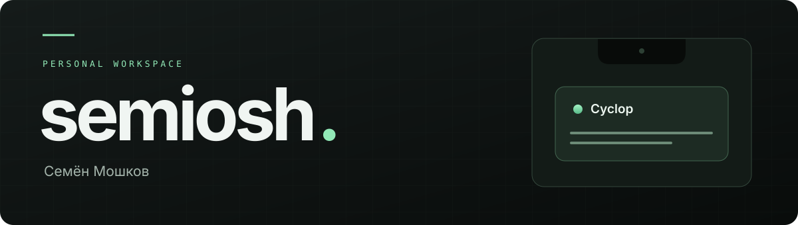

  

Привет, я **Семён Мошков** — здесь мои проекты и эксперименты с приложениями.
Сейчас работаю над своей версией **Cyclop**: превращаю область выреза MacBook в удобное место для повседневных инструментов.

 

### В работе / Cyclop

**Небольшая панель. Много полезного.**

Нативное приложение для **macOS 15+**: наведи курсор на вырез экрана, чтобы открыть инструменты.

| | Возможности |
| :--- | :--- |
| **Буфер обмена** | История текста, файлов и изображений; поиск и предпросмотр |
| **Полка для файлов** | Перетаскивание файлов между окнами через область выреза |
| **Музыка** | Управление воспроизведением, выбор устройства вывода и громкость |
| **Переводчик** | Перевод через Apple Translation с языковыми пакетами на Mac |

**Swift · SwiftUI · AppKit · macOS**

[Открыть проект ↗](https://github.com/semiosh/Cyclop) · [Документация на русском](https://github.com/semiosh/Cyclop/blob/main/README.ru.md)

Моя версия проекта <a href="https://github.com/akalikbergenov/cyclop">akalikbergenov/cyclop</a> с локальными доработками. Исходный проект распространяется по лицензии MIT; авторство сохранено.

 

---

semiosh / Семён Мошков

